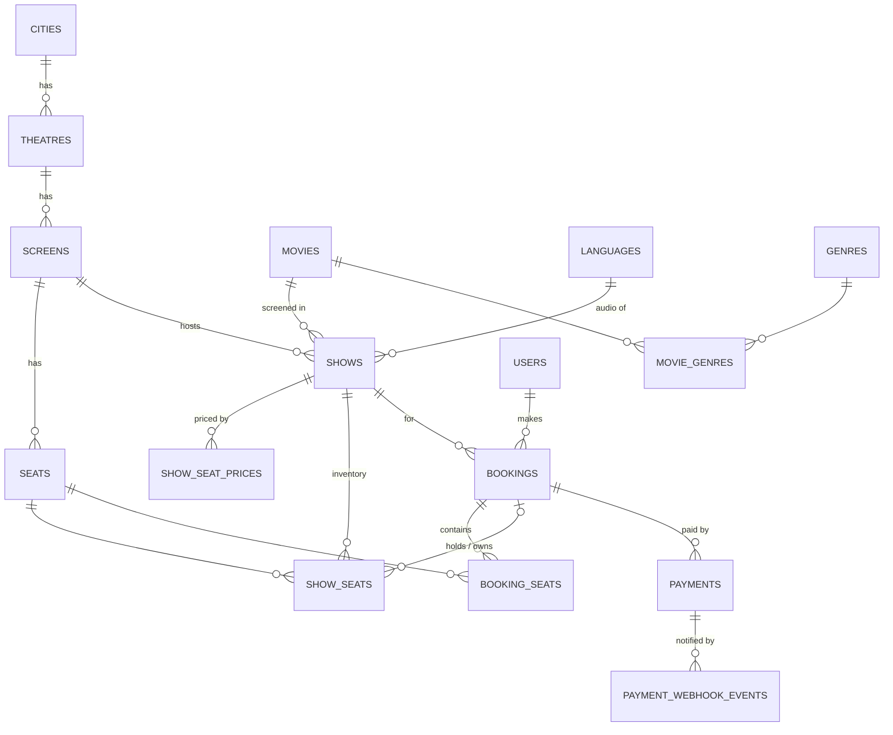

# P1 / P2 — Schema, normalization and locking strategy

**Submission SQL target:** MySQL 8.0.16+ (InnoDB). Every script in [`sql/mysql/`](../sql/mysql) runs as-is.
**Running app:** SQLite. The same schema is in [`sql/sqlite/`](../sql/sqlite), applied with `python -m app.migrate --seed`. See [§7](#7-running-on-sqlite).

| File | Purpose |
|---|---|
| [`01_schema.sql`](../sql/mysql/01_schema.sql) | P1 — `CREATE TABLE` for all 15 tables |
| [`02_seed.sql`](../sql/mysql/02_seed.sql) | P1 — sample rows (show dates are relative to `CURDATE()`) |
| [`03_p2_shows_by_theatre_and_date.sql`](../sql/mysql/03_p2_shows_by_theatre_and_date.sql) | P2 — shows at a theatre on a date, plus the 7-date picker |
| [`04_loadtest_seed.sql`](../sql/mysql/04_loadtest_seed.sql) | 10k users + a 500-seat show for the load test |

---

## 1. Entities



| Entity | What it models |
|---|---|
| `cities`, `languages`, `genres` | Reference data |
| `users` | Customers |
| `movies`, `movie_genres` | Catalogue; a movie has many genres |
| `theatres` → `screens` → `seats` | The venue. A seat is a *physical chair*; it has no status |
| `shows` | A movie on a screen at a time, in a language and format |
| `show_seat_prices` | Price per (show, seat type) |
| `show_seats` | **Seat inventory per show — the row that gets locked** |
| `bookings`, `booking_seats` | A user's hold/purchase and the seats in it |
| `payments` | Payment attempts against a booking |
| `payment_webhook_events` | Idempotency ledger of gateway callbacks |

---

## 2. Tables, attributes and sample rows

Sample rows below come from `02_seed.sql`, assuming it was loaded on **2026-10-01** at 04:30 UTC. Ids are the ones a fresh database typically assigns. Rows generated by `INSERT ... SELECT` can in principle get ids in a different order, so the seed looks seats up by (screen, row, number), never by id.

### cities
| Column | Type | Constraints |
|---|---|---|
| city_id | INT UNSIGNED | PK, auto-increment |
| name | VARCHAR(100) | NOT NULL |
| state | VARCHAR(100) | NOT NULL; UNIQUE (name, state) |

| city_id | name | state |
|---|---|---|
| 1 | Mumbai | Maharashtra |
| 2 | Bengaluru | Karnataka |

### languages / genres
| Column | Type | Constraints |
|---|---|---|
| language_id / genre_id | SMALLINT UNSIGNED | PK |
| name | VARCHAR(50) | NOT NULL, UNIQUE |

Sample: languages `1 Hindi, 2 English, 3 Tamil, 4 Telugu`; genres `1 Action, 2 Drama, 3 Comedy, 4 Sci-Fi, 5 Thriller, 6 Romance`.

### users
| Column | Type | Constraints |
|---|---|---|
| user_id | BIGINT UNSIGNED | PK |
| full_name | VARCHAR(100) | NOT NULL |
| email | VARCHAR(255) | NOT NULL, UNIQUE |
| phone | VARCHAR(15) | NOT NULL, UNIQUE |
| created_at | DATETIME(3) | NOT NULL, default now |

| user_id | full_name | email | phone |
|---|---|---|---|
| 1 | Aarav Mehta | aarav.mehta@example.com | 9810000001 |
| 2 | Diya Sharma | diya.sharma@example.com | 9810000002 |
| 3 | Kabir Nair | kabir.nair@example.com | 9810000003 |

### movies
| Column | Type | Constraints |
|---|---|---|
| movie_id | INT UNSIGNED | PK |
| title | VARCHAR(200) | NOT NULL; UNIQUE (title, release_date) |
| duration_min | SMALLINT UNSIGNED | NOT NULL, CHECK > 0 |
| certification | ENUM('U','UA','A','S') | NOT NULL |
| release_date | DATE | NOT NULL |

| movie_id | title | duration_min | certification | release_date |
|---|---|---|---|---|
| 1 | Skyline Heist | 148 | UA | 2026-09-21 |
| 2 | Monsoon Letters | 132 | U | 2026-09-28 |
| 3 | Orbit 9 | 155 | UA | 2026-09-14 |
| 4 | Laugh Riot Express | 118 | U | 2026-10-01 |

### movie_genres
| Column | Type | Constraints |
|---|---|---|
| movie_id | INT UNSIGNED | PK part, FK → movies |
| genre_id | SMALLINT UNSIGNED | PK part, FK → genres |

Sample: `(1,1) (1,5) (2,2) (2,6) (3,4) (3,1) (4,3)`.

### theatres
| Column | Type | Constraints |
|---|---|---|
| theatre_id | INT UNSIGNED | PK |
| city_id | INT UNSIGNED | FK → cities; UNIQUE (city_id, name) |
| name | VARCHAR(150) | NOT NULL |
| address | VARCHAR(255) | NOT NULL |

| theatre_id | city_id | name | address |
|---|---|---|---|
| 1 | 1 | Cineplex Lower Parel | Senapati Bapat Marg, Lower Parel, Mumbai 400013 |
| 2 | 1 | Galaxy Talkies Andheri | Link Road, Andheri West, Mumbai 400053 |
| 3 | 2 | Orion Multiplex Koramangala | 80 Feet Road, Koramangala, Bengaluru 560034 |

### screens
| Column | Type | Constraints |
|---|---|---|
| screen_id | INT UNSIGNED | PK |
| theatre_id | INT UNSIGNED | FK → theatres; UNIQUE (theatre_id, name) |
| name | VARCHAR(50) | NOT NULL |

| screen_id | theatre_id | name |
|---|---|---|
| 1 | 1 | Audi 1 |
| 2 | 1 | Audi 2 |
| 3 | 2 | Screen 1 |
| 4 | 3 | Screen 1 |

### seats
| Column | Type | Constraints |
|---|---|---|
| seat_id | BIGINT UNSIGNED | PK |
| screen_id | INT UNSIGNED | FK → screens |
| row_label | VARCHAR(3) | NOT NULL |
| seat_number | SMALLINT UNSIGNED | NOT NULL; UNIQUE (screen_id, row_label, seat_number) |
| seat_type | ENUM('REGULAR','PREMIUM','RECLINER') | NOT NULL |

Each seeded screen is 8 rows × 12 seats (A–D regular, E–G premium, H recliner).

| seat_id | screen_id | row_label | seat_number | seat_type |
|---|---|---|---|---|
| 1 | 1 | A | 1 | REGULAR |
| 53 | 1 | E | 5 | PREMIUM |
| 54 | 1 | E | 6 | PREMIUM |
| 85 | 1 | H | 1 | RECLINER |

### shows
| Column | Type | Constraints |
|---|---|---|
| show_id | BIGINT UNSIGNED | PK |
| screen_id | INT UNSIGNED | FK → screens; UNIQUE (screen_id, start_time) |
| movie_id | INT UNSIGNED | FK → movies |
| language_id | SMALLINT UNSIGNED | FK → languages |
| format | ENUM('2D','3D','IMAX_2D','IMAX_3D','4DX') | NOT NULL |
| start_time | DATETIME | NOT NULL, theatre-local |
| end_time | DATETIME | NOT NULL, CHECK end_time > start_time |
| status | ENUM('SCHEDULED','CANCELLED') | NOT NULL |

| show_id | screen_id | movie_id | language_id | format | start_time | end_time |
|---|---|---|---|---|---|---|
| 1 | 1 | 1 | 1 | 2D | 2026-10-01 10:00 | 2026-10-01 12:48 |
| 5 | 2 | 3 | 2 | IMAX_3D | 2026-10-01 09:30 | 2026-10-01 12:25 |
| 7 | 2 | 2 | 1 | 2D | 2026-10-01 16:15 | 2026-10-01 18:47 |

`end_time` is a scheduling fact (runtime + trailers + interval + cleaning, set by the theatre). It is not computed from `movies.duration_min`, so it is not a derived column.

### show_seat_prices
| Column | Type | Constraints |
|---|---|---|
| show_id | BIGINT UNSIGNED | PK part, FK → shows |
| seat_type | ENUM(...) | PK part |
| price | DECIMAL(10,2) | NOT NULL, CHECK ≥ 0 |

| show_id | seat_type | price |
|---|---|---|
| 1 | REGULAR | 200.00 |
| 1 | PREMIUM | 320.00 |
| 5 | RECLINER | 650.00 |

### bookings
| Column | Type | Constraints |
|---|---|---|
| booking_id | BIGINT UNSIGNED | PK |
| user_id | BIGINT UNSIGNED | FK → users |
| show_id | BIGINT UNSIGNED | FK → shows |
| status | ENUM('PENDING','CONFIRMED','EXPIRED','CANCELLED','FAILED') | NOT NULL |
| idempotency_key | VARCHAR(64) | NULL; UNIQUE (user_id, idempotency_key) |
| created_at / updated_at | DATETIME(3) | UTC |
| expires_at | DATETIME(3) | NOT NULL, hold deadline (UTC) |

| booking_id | user_id | show_id | status | idempotency_key | expires_at |
|---|---|---|---|---|---|
| 1 | 1 | 1 | CONFIRMED | seed-booking-1 | 2026-10-01 04:15:00 |
| 2 | 2 | 1 | PENDING | seed-booking-2 | 2026-10-01 04:35:00 |
| 3 | 3 | 1 | EXPIRED | seed-booking-3 | 2026-10-01 04:05:00 |

### show_seats — the inventory
| Column | Type | Constraints |
|---|---|---|
| show_id | BIGINT UNSIGNED | PK part, FK → shows |
| seat_id | BIGINT UNSIGNED | PK part, FK → seats |
| status | ENUM('AVAILABLE','HELD','BOOKED') | NOT NULL |
| booking_id | BIGINT UNSIGNED | NULL, FK → bookings. CHECK: NULL if and only if AVAILABLE |

| show_id | seat_id | status | booking_id |
|---|---|---|---|
| 1 | 1 (A1) | AVAILABLE | NULL |
| 1 | 53 (E5) | BOOKED | 1 |
| 1 | 54 (E6) | BOOKED | 1 |
| 1 | 61 (F1) | HELD | 2 |

### booking_seats
| Column | Type | Constraints |
|---|---|---|
| booking_id | BIGINT UNSIGNED | PK part, FK → bookings |
| seat_id | BIGINT UNSIGNED | PK part, FK → seats |
| price | DECIMAL(10,2) | price snapshot at booking time |

| booking_id | seat_id | price |
|---|---|---|
| 1 | 53 (E5) | 320.00 |
| 1 | 54 (E6) | 320.00 |
| 2 | 61 (F1) | 320.00 |
| 3 | 1 (A1) | 200.00 |

`show_seats.booking_id` records who holds the seat *now*. `booking_seats` records what a booking *asked for*, and it survives expiry, so booking 3's history is kept after A1 went back on sale.

### payments
| Column | Type | Constraints |
|---|---|---|
| payment_id | BIGINT UNSIGNED | PK |
| booking_id | BIGINT UNSIGNED | FK → bookings |
| gateway | VARCHAR(30) | NOT NULL |
| gateway_order_id | VARCHAR(64) | NOT NULL, UNIQUE |
| gateway_payment_id | VARCHAR(64) | NULL, UNIQUE |
| amount | DECIMAL(10,2) | CHECK > 0 |
| currency | CHAR(3) | default INR |
| status | ENUM('CREATED','SUCCEEDED','FAILED','REFUND_PENDING','REFUNDED') | NOT NULL |

| payment_id | booking_id | gateway_order_id | gateway_payment_id | amount | status |
|---|---|---|---|---|---|
| 1 | 1 | order_seed_0001 | pay_seed_0001 | 640.00 | SUCCEEDED |
| 2 | 2 | order_seed_0002 | NULL | 320.00 | CREATED |

### payment_webhook_events
| Column | Type | Constraints |
|---|---|---|
| event_id | VARCHAR(64) | **PK — the idempotency key** |
| gateway_order_id | VARCHAR(64) | indexed |
| event_type | VARCHAR(40) | NOT NULL |
| payload | JSON | raw event |
| outcome | VARCHAR(40) | what processing did (CONFIRMED, REFUND_BOOKING_EXPIRED, ...) |
| received_at / processed_at | DATETIME(3) | |

| event_id | gateway_order_id | event_type | outcome |
|---|---|---|---|
| evt_seed_0001 | order_seed_0001 | payment.succeeded | CONFIRMED |

---

## 3. Normalization

Notation: `X → Y` means X determines Y. For each table, every non-trivial FD has a (super)key on the left, which is the BCNF condition. That also implies 3NF and 2NF.

| Table | Candidate keys | Non-trivial FDs | Notes |
|---|---|---|---|
| cities | {city_id}, {name, state} | city_id → name, state | Two cities can share a name across states |
| users | {user_id}, {email}, {phone} | each key → all | Every determinant is a candidate key |
| movies | {movie_id}, {title, release_date} | movie_id → title, duration, cert, release | Genres moved out (multi-valued) |
| movie_genres | {movie_id, genre_id} | none | All-key table |
| theatres | {theatre_id}, {city_id, name} | theatre_id → city_id, name, address | City data is not repeated (it lives in `cities`) |
| screens | {screen_id}, {theatre_id, name} | screen_id → theatre_id, name | |
| seats | {seat_id}, {screen_id, row_label, seat_number} | seat_id → screen_id, row, number, type | No per-show state here |
| shows | {show_id}, {screen_id, start_time} | show_id → screen, movie, language, format, times, status | `theatre_id` deliberately *not* stored: screen_id → theatre_id would be transitive |
| show_seat_prices | {show_id, seat_type} | (show_id, seat_type) → price | Price does not depend on the individual seat |
| bookings | {booking_id}, {user_id, idempotency_key}\* | booking_id → user, show, status, timestamps | Total amount is *not* stored (derived from booking_seats) |
| show_seats | {show_id, seat_id} | (show_id, seat_id) → status, booking_id | Hold deadline lives on bookings. Storing it here would create booking_id → expires_at, a transitive FD |
| booking_seats | {booking_id, seat_id} | (booking_id, seat_id) → price | `show_id` not stored: booking_id → show_id would be a partial dependency (2NF) |
| payments | {payment_id}, {gateway_order_id}, {gateway_payment_id}\* | each key → all | |
| payment_webhook_events | {event_id} | event_id → all | |

\* when not NULL.

- **1NF:** every column is atomic (no lists such as "genres = Action, Thriller" and no repeating seat columns), and every table has a primary key.
- **2NF:** in the tables with composite keys (`movie_genres`, `show_seat_prices`, `show_seats`, `booking_seats`), every non-key column depends on the *whole* key.
- **3NF / BCNF:** no non-key column determines another non-key column, and every determinant is a candidate key.

### Changes from the draft schema, and why

| Draft | Problem | Fix |
|---|---|---|
| `Seats.Status` | A physical seat is available for the 6 pm show but booked for the 9 pm one. A single status per seat can't express that, and every show would contend for the same row | Per-show inventory table `show_seats (show_id, seat_id, status, booking_id)` |
| `Seats.TheatreID` | Theatres have several screens with different layouts | `screens` table; seats belong to a screen |
| Column `Row` | `ROW` is a **reserved word** in MySQL 8, so the draft DDL fails | `row_label` |
| `Bookings(SeatID, PaymentStatus)` | One booking = one seat forces multi-seat purchases into several rows that repeat user/show/payment status. Payment status duplicated `Payments.Status` | `bookings` (1 row per purchase) + `booking_seats`. Payment state lives only in `payments` |
| `Movies.Genre` | Multi-valued attribute | `genres` + `movie_genres` |
| `Theatres.Location` | Free text, so a city can't be queried reliably | `city_id` → `cities`, plus `address` |
| `Shows.Date` + `Shows.Time` | Splitting the timestamp makes range queries and overlap checks awkward | `start_time`, `end_time` DATETIME |
| No price anywhere | | `show_seat_prices` + price snapshot on `booking_seats` |
| No idempotency / hold expiry | Double-processing webhooks and never-released holds | `payment_webhook_events`, `bookings.idempotency_key`, `bookings.expires_at` |
| Nullable name/email, no CHECKs | | NOT NULL, UNIQUE and CHECK constraints throughout |

---

## 4. Concurrency and locking strategy

### What must never happen
1. **Double booking**: two bookings own the same (show, seat).
2. **Lost hold**: a user holding seats loses them before the deadline, or pays and gets nothing.
3. **Double processing**: a retried webhook confirms twice, or charges for seats that were resold.

### Pessimistic vs optimistic: trade-offs

| | Pessimistic (`SELECT ... FOR UPDATE`, then `UPDATE`) | Optimistic (version column, retry on conflict) | **Guarded UPDATE (used here)** |
|---|---|---|---|
| How | Lock the rows, check them in the app, then write | Read without locks; `UPDATE ... WHERE version = ?`; retry if 0 rows | `UPDATE ... SET status='HELD' WHERE ... AND status='AVAILABLE'`; compare affected rows |
| Round trips | 2+ while holding locks | 2 per attempt, plus retries | **1** |
| Lock hold time | Whole read-check-write span | Only during the write | Only during the write |
| Under heavy contention | Queues behind locks; deadlock risk grows with multi-seat orders | **Retry storms**: most attempts fail and retry, multiplying load | Losers fail fast with 0 rows; nothing to retry |
| Best for | Long, complex read-modify-write | Low-contention edits (profile updates) | Hot inventory state machines |

A seat rush is maximum contention on a handful of rows, which is the worst case for optimistic retries. The guarded UPDATE is a **compare-and-set executed inside InnoDB under a row lock**. Under `READ COMMITTED`, a transaction that waits on a row lock re-reads the *committed* row before applying `WHERE status='AVAILABLE'`. If the lock holder took the seat, the waiter matches 0 rows. If the holder rolled back, the waiter gets the seat.

Where a read-then-write really is needed (webhook confirmation, expiry), the code uses **pessimistic `FOR UPDATE`** on a single booking/payment row. The sweeper uses **`FOR UPDATE SKIP LOCKED`**, so several sweeper processes take disjoint batches and never wait on a booking that a webhook is confirming.

### The hold path (three layers, cheapest first)

```
POST /shows/{id}/holds
  1. Redis Lua script        all-or-nothing SET NX PX on every requested seat
                             (+ check a per-show "booked" set)      -> 409 in ~1 ms
  2. Admission gate          ≤ N DB transactions in flight per process
                             (bounded wait, then 503 + Retry-After) -> sheds bursts
  3. MySQL transaction       reclaim lapsed holds on these seats
                             INSERT booking (PENDING, expires_at = now + 5 min)
                             UPDATE show_seats ... WHERE status='AVAILABLE'
                             affected rows != requested  -> ROLLBACK -> 409
                             INSERT booking_seats (price snapshot)
                             COMMIT
```

- **Layer 3 alone guarantees correctness.** The `(show_id, seat_id)` primary key means a seat cannot exist twice for a show, and the guarded UPDATE means only one booking can move it out of AVAILABLE. If Redis is down or loses keys, requests skip layer 1 and still cannot double-book. The tests simulate this with `FLUSHALL`.
- **Layer 1 is for throughput.** In a rush for 1 seat among 10,000 users, 9,999 get their 409 from Redis and never open a DB connection. Keys use a `{show_id}` hash tag, so the multi-key script works on Redis Cluster.
- **Deadlock avoidance:** seat ids are sorted, and InnoDB locks the `IN (...)` PK range in ascending order. All paths lock in the same order: *payments → bookings → show_seats*. Error 1213/1205 is retried with jitter anyway.
- **Idempotent holds:** the `Idempotency-Key` header is stored in `bookings (user_id, idempotency_key) UNIQUE`. A client retry after a timeout returns the original booking instead of trying to take the seats again.

### Timed holds (no lost holds, no stuck seats)

- The deadline is **durable** in `bookings.expires_at`. The Redis key's TTL mirrors it but is only a cache. A Redis restart cannot extend or drop a hold.
- **Sweeper:** every 2 s, each API process runs `SELECT ... WHERE status='PENDING' AND expires_at <= now FOR UPDATE SKIP LOCKED LIMIT 200`, marks those bookings EXPIRED and sets their seats back to AVAILABLE, all in one transaction.
- **Lazy reclaim:** the hold path first expires lapsed holds on the *requested* seats, so a buyer never waits for the sweeper.
- **Early release:** `DELETE /bookings/{id}/hold` (user backs out) frees the seats immediately.
- A PENDING booking **always** holds all its seats: seats are released only in the same transaction that moves the booking out of PENDING. `verify_invariants.py` checks this after the load test.

### Idempotent payment webhooks

```
POST /payments/webhook     verify HMAC-SHA256 signature -> XADD to Redis Stream -> 202
stream consumer (group)    BEGIN
                             INSERT payment_webhook_events(event_id)   -- PK: duplicate => rollback, ack, done
                             SELECT payment ... FOR UPDATE              -- only CREATED payments can change
                             SELECT booking ... FOR UPDATE
                             PENDING and all seats HELD by it -> seats BOOKED, booking CONFIRMED, payment SUCCEEDED
                             otherwise (expired/cancelled/already paid) -> payment REFUND_PENDING
                           COMMIT; XACK
```

- The ledger insert and the state change commit **atomically**. A crash before COMMIT leaves the message unacknowledged, and it is redelivered (`XAUTOCLAIM`). A redelivery after COMMIT hits the primary key.
- Out-of-order events (e.g. `failed` after `succeeded`) are ignored because only `CREATED` payments transition.
- Late money (paid after the hold expired and the seat was resold) never double-books. It becomes `REFUND_PENDING`.
- **Burst handling with a queue:** the endpoint only verifies and enqueues, so a gateway retry storm costs one Redis write per call. Consumers drain at the rate the DB can sustain. Every API process runs a consumer in the same consumer group, so each message is processed by one worker.

---

## 5. Indexes and why

| Index | Serves |
|---|---|
| `screens UNIQUE (theatre_id, name)` | P2: theatre → its screens |
| `shows UNIQUE (screen_id, start_time)` | P2: per-screen range scan on the date; also blocks two shows starting together on one screen |
| `shows (movie_id, start_time)` | "Where is this movie playing" |
| `show_seats PK (show_id, seat_id)` | Seat map (PK prefix scan), guarded UPDATE (point lookups), availability counts |
| `show_seats (booking_id)` | Confirm/release all seats of a booking |
| `bookings (status, expires_at)` | Sweeper: `PENDING AND expires_at <= now` is a range on this index |
| `bookings UNIQUE (user_id, idempotency_key)` | Hold retries |
| `payments UNIQUE (gateway_order_id)` | Webhook → payment lookup |
| `payment_webhook_events PK (event_id)` | Duplicate detection |

The P2 date filter is written as a half-open range, `start_time >= :d AND start_time < :d + INTERVAL 1 DAY`, and **not** as `DATE(start_time) = :d`. Wrapping the column in a function would stop MySQL from using the index.

---

## 6. P2 — shows at a theatre on a date

Full script: [`sql/mysql/03_p2_shows_by_theatre_and_date.sql`](../sql/mysql/03_p2_shows_by_theatre_and_date.sql).

```sql
SET @theatre_id := 1;
SET @show_date  := CURDATE();          -- e.g. '2026-10-01'

SELECT  m.movie_id, m.title, m.certification, m.duration_min,
        l.name AS language, s.format, sc.name AS screen,
        s.show_id, s.start_time,
        TIME_FORMAT(s.start_time, '%h:%i %p') AS show_time
FROM    screens   sc
JOIN    shows     s  ON s.screen_id   = sc.screen_id
JOIN    movies    m  ON m.movie_id    = s.movie_id
JOIN    languages l  ON l.language_id = s.language_id
WHERE   sc.theatre_id = @theatre_id
  AND   s.start_time >= @show_date
  AND   s.start_time <  @show_date + INTERVAL 1 DAY
  AND   s.status = 'SCHEDULED'
ORDER BY m.title, l.name, s.format, s.start_time;
```

The grouped form, shaped like the app screen (one row per movie, timings in order):

```sql
SELECT  m.title, m.certification, l.name AS language, s.format,
        GROUP_CONCAT(TIME_FORMAT(s.start_time, '%h:%i %p')
                     ORDER BY s.start_time SEPARATOR ', ') AS show_timings
FROM    screens sc
JOIN    shows s      ON s.screen_id   = sc.screen_id
JOIN    movies m     ON m.movie_id    = s.movie_id
JOIN    languages l  ON l.language_id = s.language_id
WHERE   sc.theatre_id = @theatre_id
  AND   s.start_time >= @show_date
  AND   s.start_time <  @show_date + INTERVAL 1 DAY
  AND   s.status = 'SCHEDULED'
GROUP BY m.movie_id, m.title, m.certification, l.name, s.format
ORDER BY m.title, l.name, s.format;
```

Expected result for theatre 1 (Cineplex Lower Parel) on the seed date:

| title | certification | language | format | show_timings |
|---|---|---|---|---|
| Monsoon Letters | U | Hindi | 2D | 04:15 PM, 07:00 PM |
| Orbit 9 | UA | English | IMAX_3D | 09:30 AM, 12:45 PM, 10:00 PM |
| Skyline Heist | UA | Hindi | 2D | 10:00 AM, 01:30 PM, 05:00 PM, 08:30 PM |

The same script also has the **7-date picker** query (today + 6 days with a show count per date) and a variant with **seats left per show**.

---

## 7. Running on SQLite

The app runs on SQLite. The tables, keys, CHECK constraints and indexes are the same as the MySQL version ([`sql/sqlite/migrations/001_schema.sql`](../sql/sqlite/migrations/001_schema.sql)). ENUMs become `TEXT` + `CHECK (... IN (...))`, and timestamps are ISO text, so string order equals time order.

SQLite has no row locks: it allows **one writer at a time** per database file. The design works with that:

| Concern | MySQL | SQLite |
|---|---|---|
| Two buyers, same seat | Row lock + guarded `UPDATE ... WHERE status='AVAILABLE'` | Writers serialized by `BEGIN IMMEDIATE`, and the same guarded UPDATE decides the winner |
| Check-then-write (webhook, expiry) | `SELECT ... FOR UPDATE` | The `BEGIN IMMEDIATE` write lock is held from the transaction's first statement; `FOR UPDATE` is simply omitted by SQLAlchemy |
| Many sweepers | `SKIP LOCKED` hands each a disjoint batch | Sweepers run one after another; a batch already expired is a no-op |
| Readers during writes | MVCC | WAL mode: reads never block, and never wait for the writer |
| Burst of writers | Connection pool + row locks | One writer connection per process: requests queue on it asynchronously instead of failing with `SQLITE_BUSY`; `busy_timeout` covers other processes |

This is why the Redis fast path matters most on SQLite. Losers of a seat rush are rejected in Redis and never take the single write slot, so the writer only handles requests that can actually succeed.
